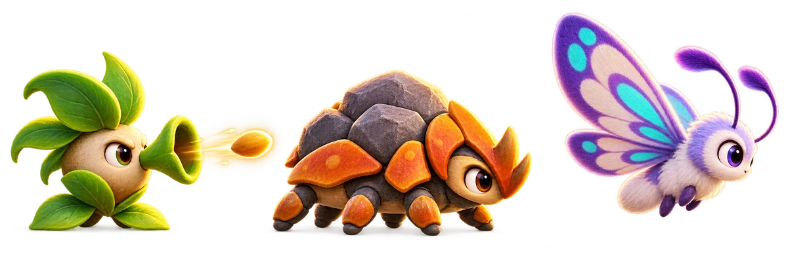

# Fase 2 — planejamento e handoff

**Atualizado:** 24/10/2026  
**Estado:** decisões de produto aprovadas; implementação ainda não iniciada.  
**Repositório:** https://github.com/atshimura/Jogo-do-Coelho-  
**Baseline:** Coelhitos 0.5.2, versionCode 12.

Este documento permite retomar o trabalho sem depender do histórico da conversa. Decisões confirmadas estão separadas das escolhas técnicas ainda necessárias.

## 1. Objetivo e decisões confirmadas

Criar a segunda fase jogável para Android. Em ritmo normal, ir do início ao portal deve levar aproximadamente 3 minutos.

| Tema | Decisão |
|---|---|
| Ambiente | Caverna colorida de fantasia com cristais luminosos. |
| Terreno | Subidas e descidas jogáveis, mais buracos; manter espinhos e fogo da fase 1. |
| Inimigo atirador | Criatura vegetal terrestre dispara sementes. O jogador consegue evitar o projétil pulando. |
| Besouro | Criatura baixa com dorso rochoso, placas laranja e seis patas curtas no conceito aprovado. |
| Voador | Mariposa lilás, quatro asas visíveis e marcas turquesa. |
| Animações | Movimentos naturais: coelho com pequenos impulsos das patas traseiras juntas; patas dos inimigos apoiadas no chão; asas da mariposa batendo em ciclo visível. |
| Buracos | Queda animada, perda de um coração e retorno a ponto seguro antes do buraco. |
| Vida | Mantêm-se 3 corações e reinício ao perdê-los. Buraco tira coração diretamente, mesmo com poder. |
| Continuidade | Preservar controles, poderes e corações da fase 1; terminar entrando calmamente no portal. |
| Estilo | Coerente com o coelho do ícone, macio, arredondado, expressivo e colorido; arte original. |

### Arte aprovada

A prancha mostra:
1. Atirador vegetal: corpo creme arredondado, folhas verdes, tubo/boca vegetal e semente dourada lançada à frente.
2. Besouro encouraçado: corpo baixo, seis patas curtas, dorso rochoso marrom com placas laranja e olhos grandes.
3. Mariposa: corpo peludo lilás, quatro asas lilás/creme com marcas turquesa, antenas longas e olhos expressivos.

A aprovação é dos conceitos visuais; não fixa escala no jogo, perspectiva final, folha de sprites ou quantidade de quadros.

## 2. Regras herdadas da fase 1

Fonte de verdade das regras gerais: docs/especificacao.md. Baseline 0.5.2:

- Android nativo em Java, orientação horizontal, pacote com.coelhitos; jogo lateral desenhado em Canvas.
- Joystick à esquerda; pulo e ação à direita. Esquerda/direita movem e viram o coelho. Pulo direcional vai para o lado indicado; sem direção, o salto é vertical.
- AÇÃO: toque curto dispara; pressão longa com direção corre. Disparo não interrompe nem inverte movimento.
- Um poder por vez; baú sorteia um poder e outro substitui o anterior.
- Poderes atuais: Espinho 25%, Fogo 20%, Pena 25%, Raio 13% por 8 s e Supersalto 17% por 20 s.
- Cenoura coletada dá um disparo; resistências de inimigos variam de um a três golpes.
- O coelho tem 3 corações; pode coletar corações adicionais. Perder os três reinicia a fase.
- Colisão comum: poder equipado é perdido antes do coração. Buraco é exceção e tira coração diretamente.
- Portal conclui somente após animação de entrada.
- Música e efeitos são sintetizados no app. Manter essa arquitetura até haver justificativa documentada para mudar.

Não alterar chances/durações dos poderes, regra de vida ou portal sem decisão documentada ou evidência técnica.

## 3. Direção de design e comportamento

### Caverna
- Contrastar o campo aberto da fase 1 com caverna fantástica e cristais luminosos, sem reduzir a leitura do jogador, chão, perigos ou projéteis.
- Usar camadas de profundidade, silhuetas de rocha, luz suave, sombras e formas arredondadas.
- As subidas e descidas alteram o piso e as colisões; morros só no fundo não atendem ao requisito.
- Decoração não pode parecer plataforma, espinho ou buraco.

### Buracos e queda
A queda deve ser um estado explícito, separado de colisão comum:

1. Detectar quando os pés cruzam a borda, usando coordenadas do mundo e não apenas da câmera.
2. Iniciar uma única vez a animação de queda/entrada no vão.
3. Bloquear movimento e tiro durante a queda; impedir cobrança dupla no mesmo evento.
4. Ao terminar a animação, retirar exatamente um coração, mesmo com poder.
5. Se restar vida, reaparecer em chão seguro antes daquele buraco, recuperar estado de chão e permitir retomar. Aplicar proteção breve contra contato duplicado.
6. Se chegar a zero, reiniciar conforme a regra existente.
7. Não deixar o coelho preso sob o piso nem atravessar o vão sem animação.

O ponto de retorno deve ser alcançável e anterior à borda; não reaparecer sobre o buraco ou dentro de inimigo.

### Inimigos e animações
- Distinguir espécies por silhueta e movimento, não só acessórios.
- Vegetal atirador: fica apoiado no chão, faz antecipação legível, dispara semente com trajetória clara e retorna ao ciclo de movimento/repouso. Aviso, cadência e velocidade são parâmetros a calibrar. Semente evitável com pulo.
- Besouro: corpo baixo/pesado; seis patas curtas acompanham terreno, alternam apoios e movimentam discretamente o corpo.
- Mariposa: voo com batida das quatro asas e leve reação do corpo; não pairar imóvel.
- Coelho: manter perfil lateral, escala e marcha quadrúpede do baseline. Ao andar/correr, patas traseiras fazem pequenos pulos juntas e as dianteiras acompanham. Não elevar o pulo normal; somente Supersalto aumenta altura/alcance.
- O projétil não nasce sobre o jogador e oferece tempo suficiente para pular.

## 4. Escolhas ainda abertas

Não definidas pelo usuário; registrar ao desenhar o nível:
- quantidade, posição, largura e espaçamento de buracos;
- número/distribuição dos novos inimigos e eventual retorno de espécies da fase 1;
- aviso visual, cadência, alcance, velocidade e trajetória das sementes;
- faixa de voo/patrulha da mariposa;
- posição/quantidade de baús, cenouras e corações;
- geometria das subidas/descidas e distâncias entre perigos;
- duração/quadros da queda, distância do retorno e proteção ao reaparecer;
- trilha/ambiente sonoro subterrâneo.

Começar reutilizando regras/quantidades da fase 1 quando apropriado e documentar ajustes para atingir 3 minutos. Essas escolhas não bloqueiam o início técnico.

## 5. Arquitetura atual

Código principal: app/src/main/java/com/coelhitos/MainActivity.java. MainActivity e GameView estão no mesmo arquivo.

- GameView.resetLevel(): popula pickups, inimigos, hazards e decoração; posiciona jogador, câmera e vida.
- GameView.update(float dt): movimento, pulo, timers, tiros, colisões, dano e transições.
- GameView.drawWorld(Canvas): ordem de renderização.
- terrainY(worldX), ramp(...), hill(...): geometria do piso atual; criar terreno/configuração próprios para fase 2.
- drawGround, drawHills, drawHazard, drawEnemy, drawRabbit, drawShot: renderização Canvas.
- resolvePlayerCollisions(...), enemyOverlapsPlayer(...), enemyTouchingPlayer(...), hurt(): colisão/dano. Queda deve ser estado explícito, não chamadas repetidas a hurt().
- Entidades no mesmo arquivo: Pickup, Enemy, Hazard, Decor, Shot e Burst. AudioEngine sintetiza música/efeitos.
- Evitar alterar listas de entidades durante iteração de colisão; isso já causou ConcurrentModificationException na fase 1.
- Fase atual usa Random(44); preservar reprodutibilidade ou permitir semente/configuração por nível.
- Testes: app/src/androidTest/java/com/coelhitos/TouchControlsTest.java; controles, poderes, saltos, colisões, portal, composição e marcha.
- CI: .github/workflows/android.yml; build/testes no emulador Android API 35.

Recomenda-se separar dados de nível da lógica compartilhada do jogador se isso reduzir duplicação. Não reescrever controles nem introduzir casos especiais que causem regressão na fase 1. Testar reset/restart da fase selecionada.

## 6. Plano em etapas

Registrar resultados em docs/andamento.md e concluir cada etapa antes da próxima.

1. Configuração de níveis: preservar fase 1 e criar configuração própria da fase 2; testar reset/restart.
2. Caverna e percurso: fundo em camadas, cristais, piso e subidas/descidas jogáveis; calibrar para 3 minutos.
3. Buracos: vãos/bordas legíveis, estado/animação de queda, perda única de coração, retorno seguro e reinício em zero.
4. Inimigos: desenhar os três conceitos; marcha/apoio do besouro, voo/batida da mariposa e semente com aviso e janela de pulo.
5. Integração: distribuir baús, cenouras, corações, espinhos/fogo e portal com as regras atuais.
6. Som/animação: efeitos de disparo, queda, perda e retorno; avaliar ambiente musical da caverna.
7. Testes: marcha, semente/evasão, queda, perda única, retorno, reinício, multitouch, poderes e portal.
8. Balanceamento: várias jogadas normais mirando 180 s; registrar método/tempo. Smoke test curto não prova duração. Avaliar em aparelho físico se disponível.
9. Release: incrementar versão, atualizar docs/notas, executar workflow, conferir APK/hash e entregar.

### Critérios de aceite
- Jogada normal termina em aproximadamente 3 minutos.
- Caverna com cristais é colorida/legível e o relevo é jogável.
- Três inimigos distintos têm movimento natural e visível.
- Semente tem leitura/tempo para pular e é evadível.
- Buraco anima, tira exatamente um coração e devolve a piso seguro anterior; zero corações reinicia.
- Fase 1, controles simultâneos, poderes, pulo normal e portal suave continuam sem regressão.
- Build/testes passam no CI, sem crashes no trecho de emulador.

## 7. Ponto de retomada e fontes
- Especificação: docs/especificacao.md.
- Histórico e etapas: docs/andamento.md.
- Arte aprovada: docs/assets/fase2-inimigos-conceito-aprovado.webp.
- Baseline: docs/release-v0.5.2.md.
- Commit de código v0.5.2: 513635e434809fdf070318c7fcd2f808f9a006a9.
- CI da v0.5.2: #48 (https://github.com/atshimura/Jogo-do-Coelho-/actions/runs/39828135547), 13 testes instrumentados passaram no Android Emulator API 35.
- CI após documentação da baseline: #49 (https://github.com/atshimura/Jogo-do-Coelho-/actions/runs/39829000728).
- APK baseline Coelhitos-v0.5.2-debug.apk; SHA-256 8a1904be5ec82eea12111d2351cf07da080cda443f8bae3e2258dc3e9c3b6ed8.
- Build: clonar https://github.com/atshimura/Jogo-do-Coelho-.git; requer JDK 17, Android SDK Platform 35 e Gradle 8.9 ou compatível. Rodar gradle assembleDebug; testes locais com gradle connectedAndroidTest e emulador/dispositivo. Workflow android.yml é gate obrigatório.
- Alteração documental não muda o APK nem o hash da baseline.
